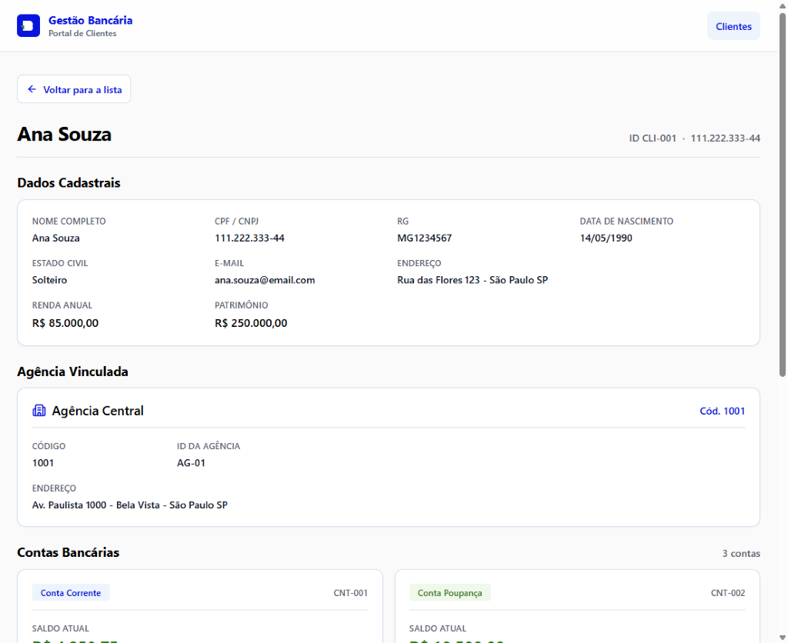
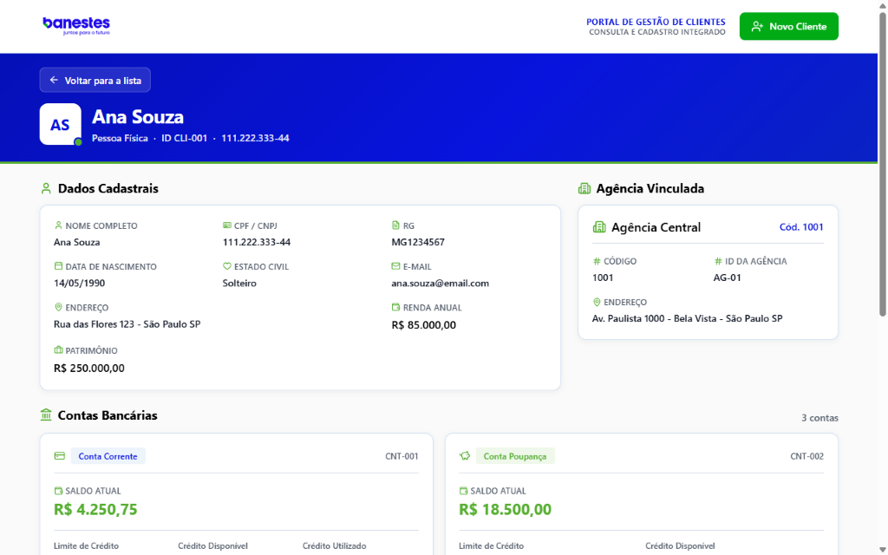
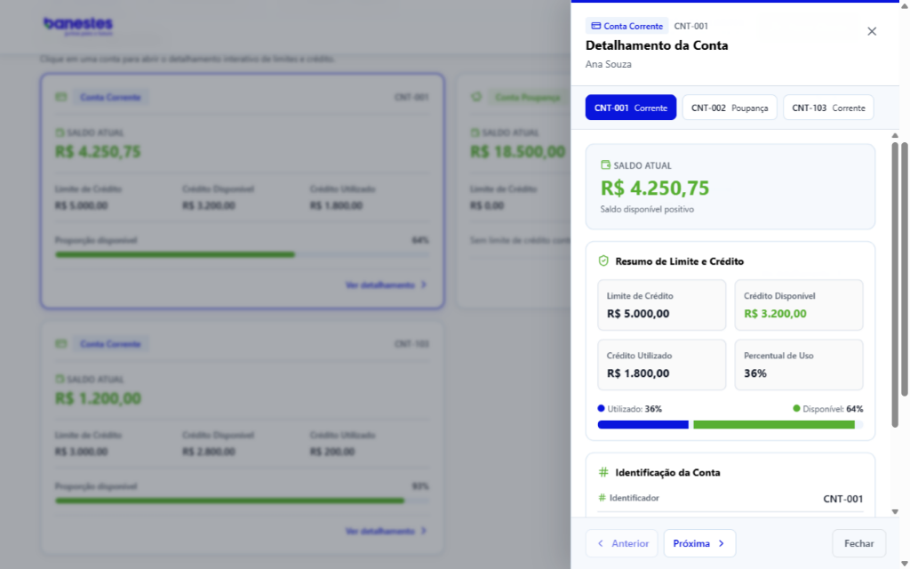
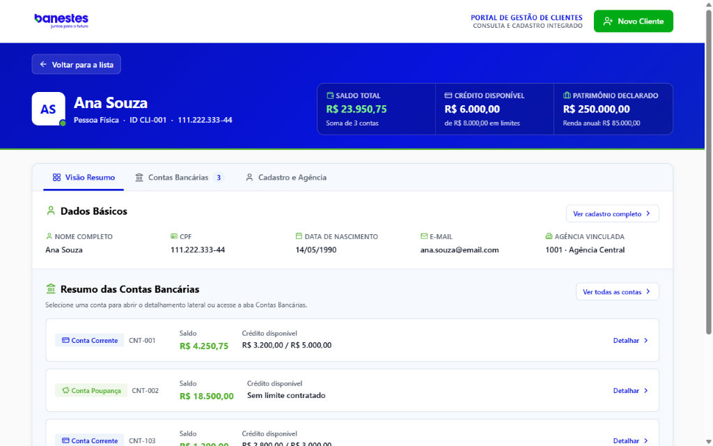

# Gestão de Clientes Bancários — Portal Banestes

Sistema web frontend para consulta, filtragem, detalhamento e cadastro em memória de clientes bancários, contas e agências, consumindo dados em tempo de execução a partir de planilhas públicas do Google Sheets (CSV).

> **Deploy online (Vercel):** `https://<seu-projeto>.vercel.app` *(espaço reservado para o link após publicação na Vercel)*

---

## Visão Geral e Funcionalidades Implementadas

### 1. Listagem e Pesquisa de Clientes (`/`)
- **Leitura viva em tempo de execução:** busca simultânea das três planilhas (`clientes`, `contas` e `agencias`) via `Fetch API` + `Response.text()` + `Promise.all`, com suporte a cancelamento via `AbortController`.
- **Faixa institucional e métricas:** cabeçalho e banner Banestes exibindo o total de clientes, agências e contas carregadas em memória.
- **Busca e filtros combinados (`SearchToolbar`):**
  - Busca textual instantânea por **Nome**, **Nome Social** ou **CPF/CNPJ** (ignorando acentos, caixa e pontuação).
  - Filtro por **Documento**: `Todos (CPF e CNPJ)`, `Somente CPF` e `Somente CNPJ`.
  - Filtro dinâmico por **Agência**: dropdown customizado (`SelectDropdown`) populado com as agências carregadas.
  - Botão **Limpar filtros** e reset automático para a página **1** sempre que qualquer critério muda.
- **Listagem responsiva (`ClientList`):** tabela semântica (`<table>`, `<caption>` acessível, `<th scope="col">`) no desktop (`>= 768px`) e cards empilhados no mobile (`< 768px`), com indicação discreta de nome social e distinção `PF`/`PJ`.
- **Paginação (`Pagination`):** máximo de 10 clientes por página, contador `"Mostrando X–Y de Z clientes"`, janela de 3 páginas nas extremidades e `aria-current="page"`.
- **Estados resilientes (`StatusMessage`):** skeleton de carregamento, aviso de erro com ação `"Tentar novamente"` e empty state para consultas sem resultado.

### 2. Cadastro em Memória (`ClientFormModal`)
- Modal nativo em `<dialog>` (`showModal()` / `close()`), fechamento por `Esc`, clique no backdrop e retorno automático de foco.
- Validação declarativa com **React Hook Form + Zod v4**, incluindo verificação completa dos dígitos verificadores de CPF e CNPJ (`validators.ts`), aviso amigável de duplicidade com registros existentes, calendário customizado (`DatePicker` com `react-day-picker` + `date-fns`) e seletor de agências (`SelectDropdown`).
- Geração de identificador com `crypto.randomUUID()`, inserção imediata no topo da lista em memória (`BankDataContext`), fechamento automático do modal e notificação acessível (`role="status"`).

### 3. Detalhes Interativos do Cliente (`/clientes/:id`)
- **Hero institucional com KPIs integrados:** identidade do cliente à esquerda e resumo financeiro consolidado à direita (**Saldo Total**, **Crédito Disponível** e **Patrimônio Declarado**).
- **Folha branca unificada com abas acessíveis (`Visão Resumo`, `Contas Bancárias`, `Cadastro e Agência`):**
  - **Visão Resumo:** apresenta **Dados Básicos** e **Resumo das Contas Bancárias** em blocos delimitados na mesma superfície contínua, com atalhos diretos para detalhamento.
  - **Contas Bancárias:** barra consolidada de uso de limites + cards responsivos com *container queries* e alinhamento automático em 2 ou 3 colunas no desktop.
  - **Cadastro e Agência:** dados cadastrais completos à esquerda e agência vinculada à direita (`AgencyCard`) com altura alinhada.
- **Drawer lateral animado (`AccountDrawer`):** implementado com `<dialog>` nativo, exibindo saldo, limite, crédito disponível, crédito utilizado, percentual de uso com barra segmentada e navegação entre as contas do cliente.
- **Tratamento de anomalias:** mensagens dedicadas para ID de cliente não encontrado, código de agência inexistente na planilha (ex.: `CLI-021`, código `9999`) ou cliente sem contas vinculadas.

---

## Decisões Técnicas e Normalização dos Dados CSV

Seguindo o princípio **KISS**, o projeto utiliza React 19 funcional, TypeScript estrito (`strict: true`, zero `any`), CSS puro baseado em variáveis de design (`src/styles/tokens.css`) e fluxo unidirecional de dados, evitando bibliotecas externas de estado global ou frameworks CSS.

A inspeção direta das planilhas vivas do Google Sheets revelou inconsistências reais tratadas em `src/services/bankApi.ts` e `src/utils/normalizers.ts`:

1. **Colunas extras vazias no CSV:** a planilha de `clientes` exporta 14 colunas em branco à direita. Em `parseCsvRows` (PapaParse `{ header: true, skipEmptyLines: true }`), `transformHeader` renomeia cabeçalhos vazios para `__empty_<index>`, evitando falsos avisos de cabeçalho duplicado.
2. **Zeros à esquerda removidos pelo Google Sheets:** células numéricas sem formatação de texto perdem zeros à esquerda (ex.: CPFs curtos como `11122233` que originalmente são `00011122233`). `normalizeCpfCnpj` restaura zeros com `padStart(11, "0")` (ou `14` dígitos para CNPJ), **preservando** valores compostos apenas por zeros (como `"0"` na conta órfã `CNT-108`) para não mascarar anomalias reais.
3. **Separação entre ingestão e cadastro:** `99` dos documentos da base de teste são fictícios (ex.: `11122233344`, `12345678000199`). Por isso, a leitura do CSV não descarta registros por dígito verificador, enquanto o formulário de **Novo Cliente** exige CPF/CNPJ matematicamente válido via `validators.ts`.
4. **Datas sem deslocamento de fuso horário:** `parseDate` interpreta strings `YYYY-MM-DD` e `DD/MM/YYYY` usando construtor local `new Date(year, month - 1, day)` e valida overflow de calendário, evitando o recuo de `-1 dia` causado por `new Date("YYYY-MM-DD")` em UTC.
5. **Números e domínios textuais flexíveis:** `parseNumber` trata tanto formato americano (`"85000.00"`, `"1,250.50"`) quanto brasileiro (`"R$ 1.250,50"`). `normalizeEstadoCivil` e `normalizeTipoConta` normalizam caixa, acentos e flexões de gênero (ex.: `"Solteira"` → `"Solteiro"`, `"Poupança"` / `"POUPANCA"` → `"poupanca"`).
6. **Linhas inválidas e acessibilidade:** registros sem campos essenciais são ignorados com `console.warn` descritivo sem interromper o carregamento. Toda a interface adota WCAG 2.2 AA (`:focus-visible`, `tabular-nums`, elementos nativos `<button>`, `<Link>`, `<dialog>`, `prefers-reduced-motion`).

---

## Arquitetura de Pastas

```text
├── index.html                        # HTML raiz (lang="pt-BR", favicon Banestes e metadados)
├── vercel.json                       # Rewrite de todas as rotas SPA para /index.html
├── SPEC.md                           # Especificação técnica e contratos de domínio
├── docs/
│   └── screenshots/                  # Registro visual da evolução do design
└── src/
    ├── main.tsx                      # Entry point, BrowserRouter e estilos globais
    ├── App.tsx                       # Layout persistente (Header/Footer), rotas e modal global
    ├── assets/                       # Logotipos oficiais Banestes
    ├── styles/
    │   ├── tokens.css                # Design tokens (paleta Banestes, tipografia, espaçamento)
    │   └── global.css                # Reset acessível, .sr-only, botões e utilitários
    ├── types/
    │   └── models.ts                 # Interfaces Cliente, Conta, Agencia e tipos auxiliares
    ├── utils/
    │   ├── normalizers.ts            # Funções puras de normalização CSV -> modelos
    │   ├── formatters.ts             # Formatação BRL, datas BR e máscara CPF/CNPJ
    │   └── validators.ts             # Validação matemática de CPF e CNPJ
    ├── services/
    │   └── bankApi.ts                # Fetch API + Response.text() + PapaParse + Promise.all
    ├── schemas/
    │   └── clienteSchema.ts          # Schema Zod do cadastro de cliente
    ├── context/
    │   ├── BankDataContext.tsx       # Estado em memória, carga inicial e addCliente
    │   └── useBankData.ts            # Hook de consumo do contexto
    ├── hooks/
    │   └── useClientFilters.ts       # Busca textual/numérica, filtro CPF/CNPJ/agência e paginação
    ├── components/
    │   ├── AccountCard/              # Card interativo de conta com container queries e barra de limite
    │   ├── AccountDrawer/            # Painel lateral deslizante (<dialog>) de detalhamento da conta
    │   ├── AgencyCard/               # Exibição da agência vinculada e fallback resiliente
    │   ├── ClientFormModal/          # Modal acessível de cadastro (<dialog> + RHF + Zod)
    │   ├── ClientList/               # Tabela semântica (desktop) e cards (mobile)
    │   ├── DatePicker/               # Seletor de data acessível em português
    │   ├── Footer/                   # Rodapé institucional com canais de atendimento
    │   ├── Header/                   # Cabeçalho sticky com logo Banestes e ação "+ Novo Cliente"
    │   ├── Pagination/               # Paginação acessível com janela fixa de 3 páginas
    │   ├── SearchToolbar/            # Busca, filtro de documento (CPF/CNPJ) e agência
    │   ├── SelectDropdown/           # Combobox/listbox acessível em popover
    │   └── StatusMessage/            # Loading skeleton, erro com retry e empty state
    └── pages/
        ├── ClientListPage/           # Rota / — Carteira de clientes
        └── ClientDetailPage/         # Rota /clientes/:id — Detalhes do cliente em folha unificada
```

Fluxo de dependências unidirecional dentro de `src/`:
`types` / `utils` → `services` → `context` / `hooks` → `components` → `pages`.

---

## Como Executar Localmente

### Pré-requisitos
- **Node.js 20+** e **npm** instalados.

### Comandos
```bash
# 1. Instalar dependências
npm install

# 2. Iniciar servidor de desenvolvimento
npm run dev

# 3. Validar tipagem TypeScript e lint (Oxlint)
npx tsc --noEmit
npm run lint

# 4. Gerar build de produção e pré-visualizar localmente
npm run build
npm run preview
```

Em produção na **Vercel**, o arquivo `vercel.json` redireciona todas as rotas para `/index.html`, garantindo que recarregamentos diretos em rotas como `/clientes/CLI-001` funcionem sem erro 404.

---

## Evolução do Design (Extra)

Registro da evolução visual da tela de detalhes (`/clientes/CLI-001`) entre as branches do projeto, partindo da base funcional sem identidade de marca até a versão unificada final:

### 1. Estrutura inicial funcional (sem identidade visual Banestes — commit `01f9a1b`)


### 2. Aplicação da identidade visual Banestes (`design/banestes-visual`)


### 3. Detalhes interativos com KPIs, abas e Drawer lateral (`design/banestes-interativo`)


### 4. Versão final unificada com KPIs integrados no hero azul (`design/banestes-interativo-v2`)

